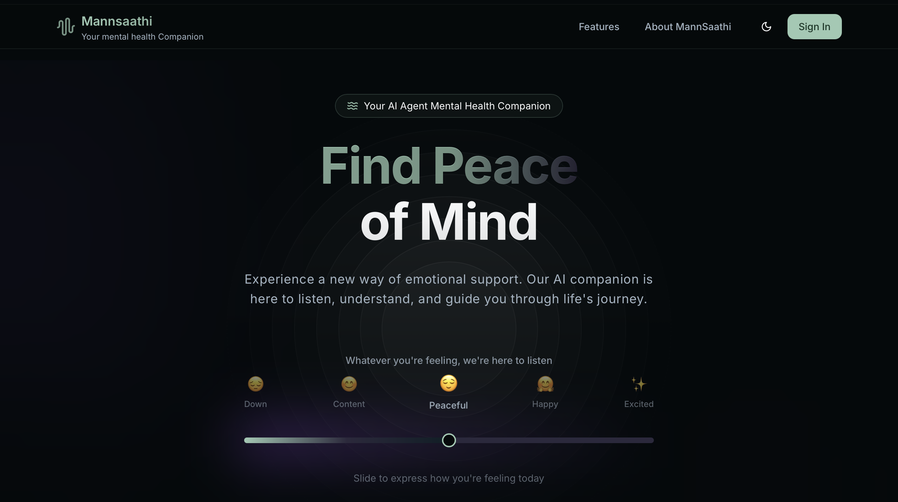
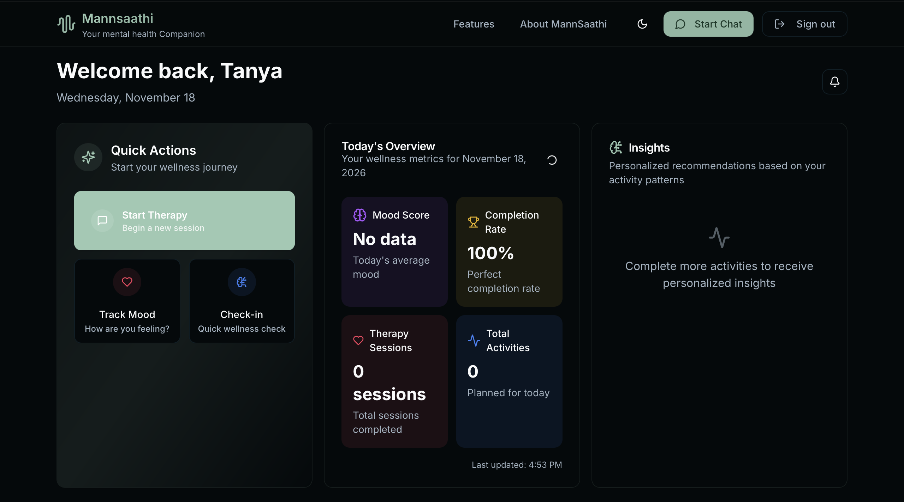
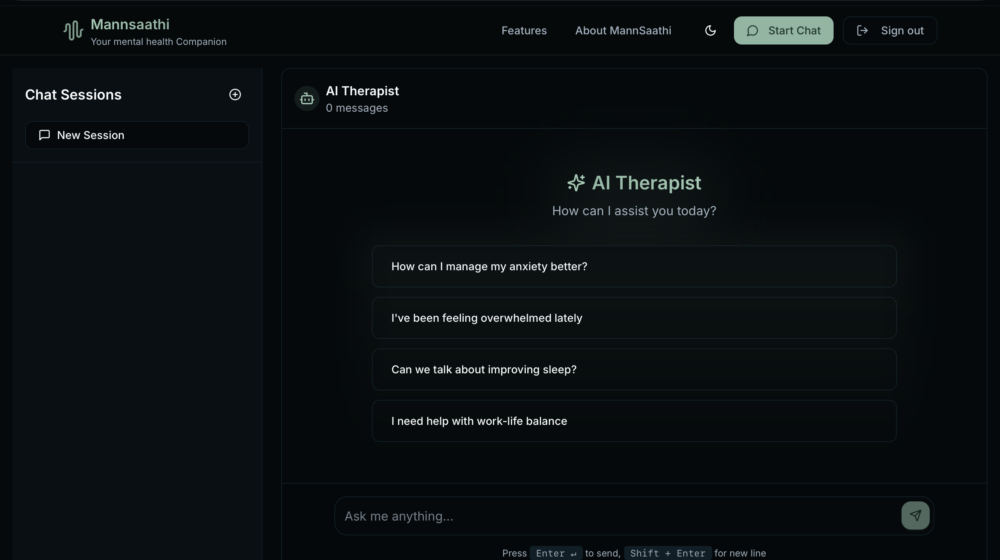
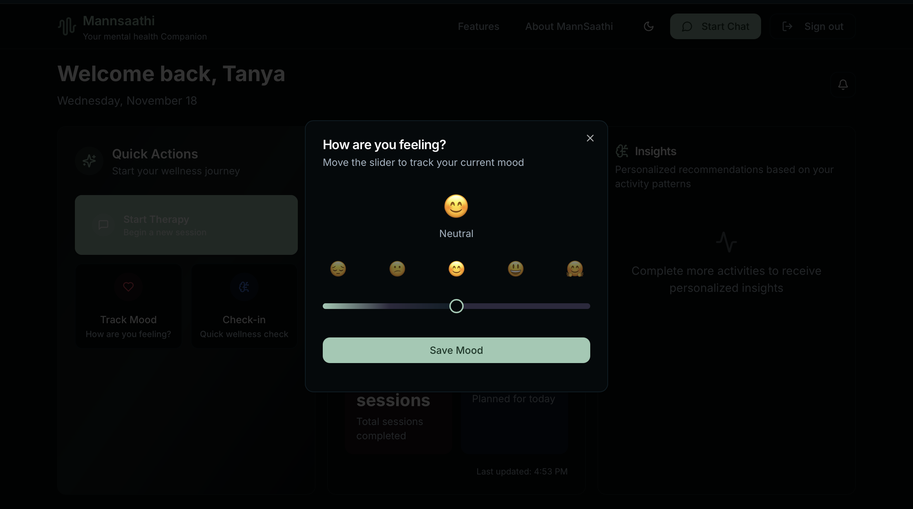

<div align="center">

# 🌿 MannSaathi-AI

**Your mind's companion: an autonomous AI/ML agent for mental health support.**

Understands how you feel, tracks your mood, talks it out with an empathetic AI, and aims to flag early signs of a crisis.

[](https://YOUR-FRONTEND.vercel.app)


[🌐 Live Demo](https://YOUR-FRONTEND.vercel.app) · [⚙️ Backend API](https://YOUR-BACKEND.onrender.com/health) · [🐞 Report a bug](https://github.com/tanyasingh0307/MannSaathi-AI/issues)

</div>

---

## 📖 About

**MannSaathi** means *a companion for the mind*. It is the final year project of the
Department of Computer Science & Engineering, GL Bajaj Institute of Technology and
Management, Greater Noida (session 2026-27).

Most mental health chatbots only reply to messages. MannSaathi is being built as an
**autonomous AI/ML agent** that understands emotion in real time, adapts to each user,
tracks mood over time, and is designed to detect high-risk patterns and start support
steps early.

> 🔗 **Try it live:** https://YOUR-FRONTEND.vercel.app
> The backend runs on a free plan, so the very first request may take a short while to wake up.

## 📸 Screenshots

<table>
  <tr>
    <td align="center" width="50%">
      <br>
      <sub><b>Landing page</b>: a mood slider to start with how you feel</sub>
    </td>
    <td align="center" width="50%">
      <br>
      <sub><b>Dashboard</b>: quick actions, today's overview and insights</sub>
    </td>
  </tr>
  <tr>
    <td align="center" width="50%">
      <br>
      <sub><b>AI chat</b>: session history and conversation starters</sub>
    </td>
    <td align="center" width="50%">
      <br>
      <sub><b>Mood tracking</b>: log how you feel in a few seconds</sub>
    </td>
  </tr>
</table>

## ✨ Features

**Available in the app**
- 💬 **AI companion chat** powered by Google Gemini, with session history
- 😊 **Mood tracking** with an emoji slider and a timeline of past entries
- 📊 **Dashboard** with today's overview, quick actions and insights
- 🔐 **Secure authentication** using JWT and hashed passwords
- 🌗 **Light and dark themes**

**Agent capabilities (final year scope, in progress)**
- 🧠 **Real-time emotion and sentiment detection** from each message (NLP)
- 🎯 **Adaptive support** that changes style per user and mood
- 🚨 **Crisis-risk prediction** that flags high-risk emotional patterns early
- 🤝 **Intervention protocol** that suggests calming steps and helplines when risk is high
- 🤖 **Autonomous agent layer** built with the Zerepy framework
- 🧘 **Calming activities**: guided breathing, ocean waves, zen garden, forest sounds

## 🔄 How It Works

```
User message → Frontend → Backend → Emotion check → Crisis check
            → Gemini reply (or intervention) → Save mood in database → Reply shown to user
```

## 🛠️ Tech Stack

| Layer | Technology |
|-------|------------|
| Frontend | Next.js 14 (App Router), TypeScript, Tailwind CSS, shadcn/ui, Framer Motion, Recharts |
| Backend | Node.js, Express, TypeScript |
| Database | MongoDB Atlas (Mongoose) |
| AI / LLM | Google Gemini API |
| Emotion understanding | NLP-based sentiment and emotion classification (in progress) |
| Autonomous agent | Zerepy agent framework (in progress) |
| Safety | Crisis-prediction model (in progress) |
| Background jobs | Inngest |
| Auth | JSON Web Tokens, bcrypt |
| Deployment | Vercel (frontend), Render (backend) |

## 📁 Project Structure

```
MannSaathi-AI/
├── backend/             # Express + TypeScript API
│   └── src/
│       ├── agent/       # Emotion classifier, crisis model, intervention logic
│       ├── controllers/ # Request handlers
│       ├── inngest/     # Background functions
│       ├── middleware/  # Auth and error handling
│       ├── models/      # Mongoose schemas
│       ├── routes/      # API routes
│       └── utils/       # DB connection, logger
├── frontend/            # Next.js app
│   ├── app/             # Pages and API proxy routes
│   ├── components/      # UI, chat, mood, games
│   └── lib/             # API helpers, hooks, context
└── docs/
    └── screenshots/     # Images used in this README
```

## 🚀 Getting Started

### Prerequisites
- Node.js 18+
- A [MongoDB Atlas](https://www.mongodb.com/atlas) cluster (free tier works)
- A [Google Gemini API key](https://aistudio.google.com/apikey)

### 1. Clone the repository
```bash
git clone https://github.com/tanyasingh0307/MannSaathi-AI.git
cd MannSaathi-AI
```

### 2. Run the backend
```bash
cd backend
npm install
cp .env.example .env     # then fill in your values
npm run dev
```
The API runs at `http://localhost:3001`.

### 3. Run the frontend
Open a second terminal:
```bash
cd frontend
npm install
cp .env.example .env.local
npm run dev
```
The app runs at `http://localhost:3000`.

## 🔑 Environment Variables

**`backend/.env`**
| Variable | Description |
|----------|-------------|
| `PORT` | Server port (default `3001`) |
| `NODE_ENV` | `development` or `production` |
| `MONGODB_URI` | MongoDB Atlas connection string |
| `JWT_SECRET` | Long random string used to sign tokens |
| `GEMINI_API_KEY` | Google Gemini API key |

**`frontend/.env.local`**
| Variable | Description |
|----------|-------------|
| `BACKEND_API_URL` | Backend URL, e.g. `http://localhost:3001` |

## 🔌 API Overview

| Method | Endpoint | Description |
|--------|----------|-------------|
| GET | `/health` | Health check |
| POST | `/auth/register` | Create an account |
| POST | `/auth/login` | Log in and receive a token |
| GET | `/auth/me` | Get the current user |
| POST | `/chat/sessions` | Start a chat session |
| POST | `/chat/sessions/:id/messages` | Send a message to the AI |
| GET | `/chat/sessions/:id/history` | Get a session's messages |
| POST / GET | `/api/mood` | Log or list moods |
| POST / GET | `/api/activity` | Log or list activities |

_Final routes will be confirmed as the backend is built._

## ☁️ Deployment

| Part | Platform | Link |
|------|----------|------|
| Frontend | Vercel | https://YOUR-FRONTEND.vercel.app |
| Backend | Render | https://YOUR-BACKEND.onrender.com |

- **Backend → Render:** root directory `backend`, build `npm install && npm run build`, start `npm start`. Add the backend env vars in the dashboard.
- **Frontend → Vercel:** root directory `frontend`. Set `BACKEND_API_URL` to your Render URL.

## 🗺️ Roadmap

- [x] Project setup
- [x] Frontend: landing page, dashboard, mood tracking and chat screens
- [ ] Backend: models, auth, mood, activities
- [ ] Backend: AI chat with Gemini
- [ ] NLP emotion and sentiment detection
- [ ] Crisis-prediction model and intervention protocol
- [ ] Zerepy autonomous agent integration
- [ ] Calming activities (breathing, ocean, zen garden, forest)
- [ ] Testing and evaluation
- [ ] Deployment

## 👥 Team

Final year project, Department of Computer Science & Engineering, GL Bajaj Institute of Technology and Management, Greater Noida. Session 2026-27. Group ID: GC_2026_089.

| Name | Role |
|------|------|
| [Tanya Singh](https://github.com/tanyasingh0307) | Team member |
| Tushar Gupta | Team member |
| Utkarsh Chawla | Team member |
| Devanshu Rajput | Team member |

**Under the supervision of:** Ms. Shipra Singh, Assistant Professor, CSE, GLBITM.

## ⚠️ Disclaimer

MannSaathi-AI is a supportive companion, **not** a replacement for professional
mental health care, diagnosis, or treatment. It does not diagnose any condition.

If you are in crisis or thinking about harming yourself, please reach out right away:
- **Tele-MANAS (India, free, 24x7):** 14416 or 1800-891-4416
- **Emergency services:** 112

## 📄 License

Released under the [MIT License](LICENSE).

## 🙏 Acknowledgements

Inspired
